<div align="center">

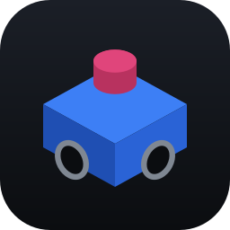<br>

**라즈베리 파이 + Pico 로 움직이는 차동 구동 로봇을, Windows PC 에서 보고 · 조종하고 · 지도 위 목표로 보내는 전체 작업 공간**<br>
<sub>A complete workspace to watch, drive and navigate a Raspberry Pi + Pico differential-drive robot from a Windows PC —
ROS 2, a Qt 6 Quick 3D dashboard, SLAM/Nav2, and a mock robot so you can hack on it without hardware.</sub>

[](https://github.com/ghlee0786/ros-mobile-robot/actions/workflows/ci.yml)


-22314E)


[**로봇 없이 5분 만에 띄우기**](#-로봇-없이-5분-만에) · [기능](#-기능) · [구성](#-시스템-구성) · [시험](#-시험--로봇-없이도-검증한다) · [기여](#-함께-만들기)

</div>

---

## 🎬 움직이는 모습

<table>
<tr>
<td width="50%">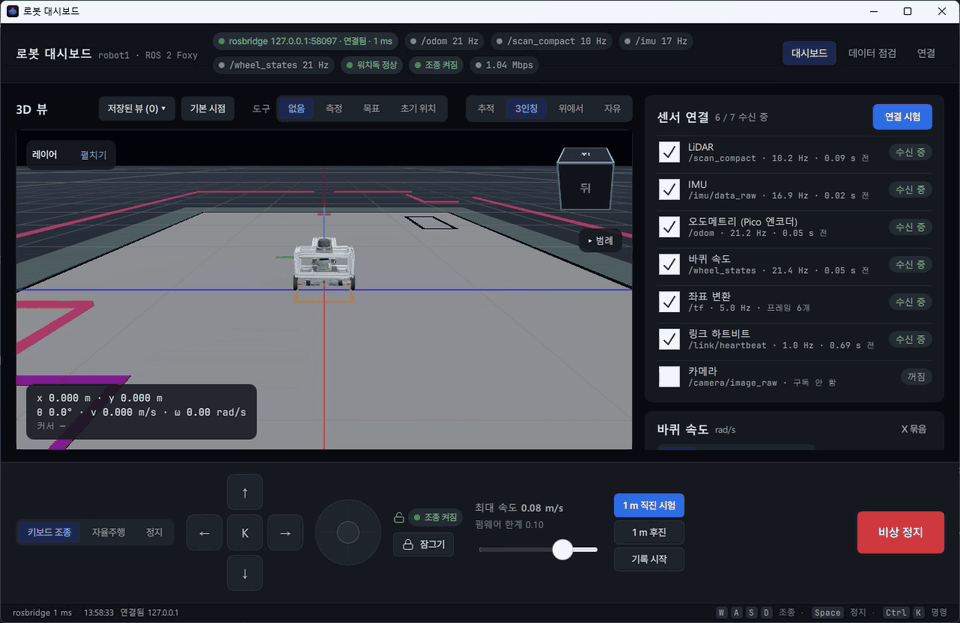<br><sub><b>3인칭</b> — 클릭한 목표로 Nav2 주행 · LiDAR 잔상 · 지역 코스트맵 · footprint · 계획 경로</sub></td>
<td width="50%">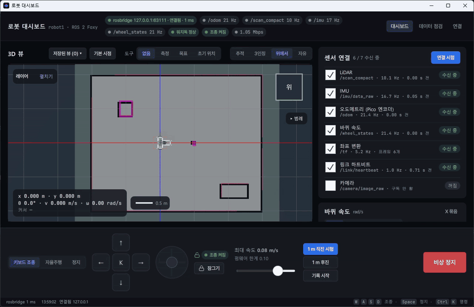<br><sub><b>위에서</b> — 직교 카메라로 지도 · LiDAR · 경로가 정확히 겹친다(RViz TopDownOrtho 방식)</sub></td>
</tr>
<tr>
<td colspan="2">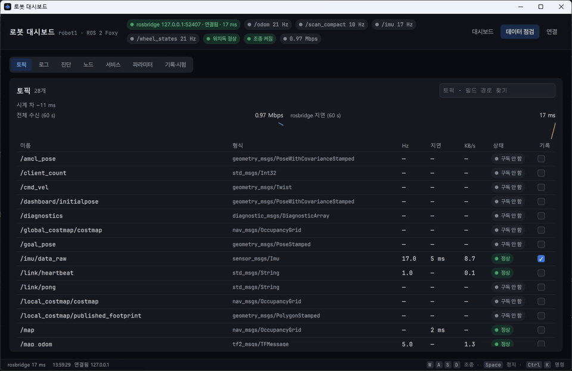<br><sub><b>데이터 점검</b> — 토픽 Hz · 지연 · KB/s, 전체 수신량 · rosbridge 지연 그래프, 원문 메시지 · 로그 · 진단 · 노드 · 서비스 · 파라미터 탭</sub></td>
</tr>
</table>

<sub>실제 로봇: 파이 LiDAR 로 PC SLAM 이 만든 지도 · 전역 코스트맵을 대시보드가 RViz2 와 같은 색 규칙으로 그린 화면.</sub>

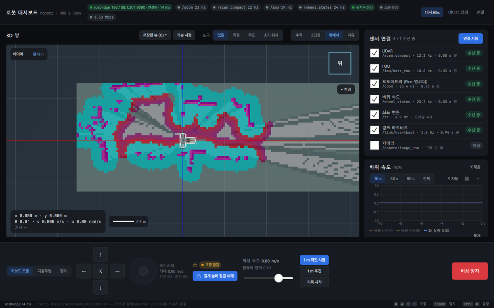

<sub>위의 움직이는 화면은 실제 대시보드를 <b>모의 로봇</b>(`tooling/mockbridge`)에 붙여 `make_demo_gif.py` 로 녹화한 것입니다 — 여러분 PC 에서 그대로 재현됩니다.</sub>

## ✨ 기능

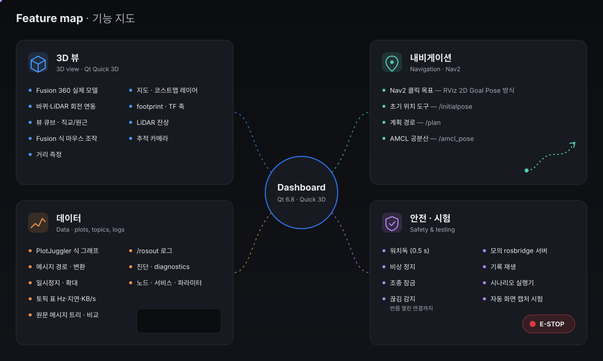

<details>
<summary><b>자세히 보기</b></summary>

| 영역 | 기능 |
|---|---|
| **3D 뷰** | Fusion 360 실제 로봇 모델(경량 glb, 바퀴 · LiDAR 헤드가 실제 데이터로 회전) · 추적 / 3인칭 / 위에서(직교) / 자유 시점 · 뷰 큐브(우클릭 뷰 메뉴) · Fusion 360 식 마우스 · 거리 측정 · 저장된 뷰 |
| **레이어** | LiDAR 점(잔상 0~10 s, 단색 · 거리 · 강도 색) · 이동 경로(그라디언트) · 지도(map/costmap/raw 팔레트, 투명도) · 전역 · 지역 코스트맵 · footprint · TF 축 · AMCL · 오도메트리 공분산 타원 |
| **내비게이션** | 누른 곳 = 목표, 끄는 쪽 = 도착 방향(RViz 2D Goal Pose 방식) → `/goal_pose` · 초기 위치 도구 → AMCL · 계획 경로 · 취소 |
| **그래프** | PlotJuggler 식: 메시지 경로(`/odom.twist.twist.linear.x`, `/scan.ranges[3]`) · 시간 창 10/30/60 s · 일시정지 · 확대 · X 묶음 · Y 자동 · 변환(미분 · 이동평균 · 적분 …) · 구간 통계 · CSV/PNG |
| **데이터 점검** | 토픽 표(Hz · 지연 · 시계 차 · KB/s · 기록) · 퍼지 검색 · 원문 메시지 트리와 직전 메시지 비교 · `/rosout` 로그(심각도 · 노드 · 검색 · 강조 규칙) · 진단 · 노드 · 서비스 호출 · 파라미터 편집 |
| **조종 · 안전** | 키보드 · 화면 버튼 · 가상 조이스틱 · 조종 잠금(길게 눌러 해제 · 30 s 무입력 잠김) · 비상 정지 · 1 m 보정 직진 시험 · 끊김 · 반쯤 열린 연결 감지 |
| **디자인** | 다크 기본 · 라이트 테마 · 디자인 토큰(Theme.qml) · Pretendard · lucide 아이콘 · `Ctrl+K` 명령 팔레트 · 상태 바 · 빈/로딩/오류 상태 |
| **시험 훅** | `--url --actions --state --screenshot --trace --quit-after --no-publish --no-model` — 사람이 없어도 화면 · 상태를 기록해 판정 |

</details>

## 🧭 시스템 구성

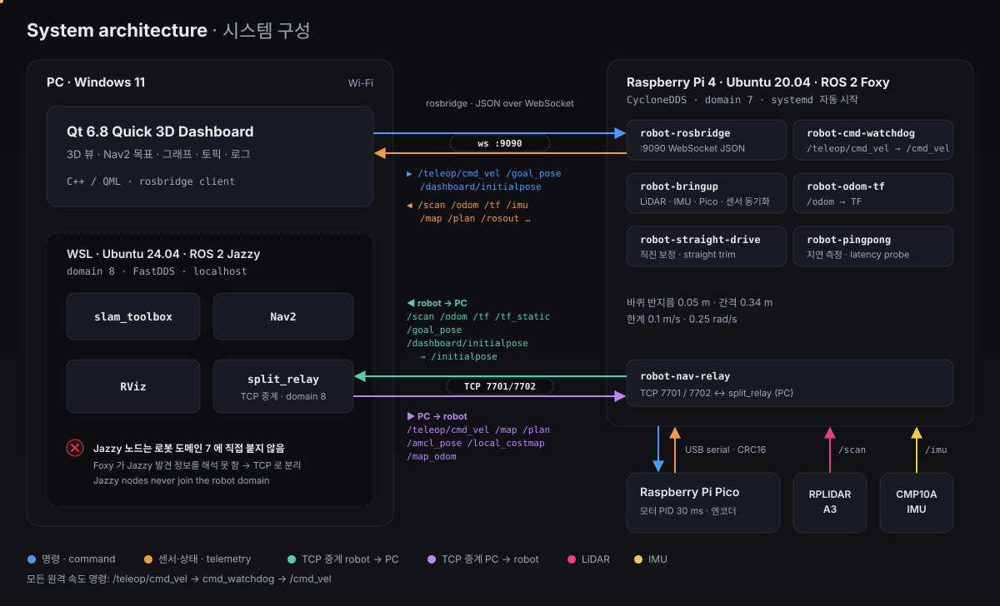

- **대시보드 ↔ 로봇: rosbridge(WebSocket JSON).** ROS 버전과 상관없이 동작합니다. 파이의 rosbridge(Python)는 한 코어가 상한이라
  토픽별 throttle 하한(IMU 50 ms · TF 200 ms · 지도 2 s)을 두고, LiDAR 는 파이의 `scan_compact` 노드가 mm 정수 배열(`/scan_compact`)로
  다시 내 보내 JSON 을 4~5 배 줄입니다(36.7 KB → 8.4 KB/스캔).
- **SLAM/Nav2 ↔ 로봇: 도메인 분리 + TCP 중계.** PC 의 Jazzy 내비 스택은 PC 내부 도메인 8(FastDDS)에서 돌고, 로봇 쪽 중계는
  파이 위의 Foxy 프로세스(`robot-nav-relay`)가 맡습니다. **Jazzy 노드는 로봇 도메인에 직접 붙지 않습니다** — Foxy 가 Jazzy 의
  발견 정보를 해석하지 못해 rosapi 가 죽고 rosbridge 가 멈추는 것을 실기에서 재현하고 이 구조로 고쳤습니다.
- 파이의 `initialpose_node` 가 5 초마다 `/initialpose`=(0,0,0) 를 내므로, 대시보드 초기 위치는 `/dashboard/initialpose` 로 보내고 PC 에서
  `/initialpose` 로 이름을 바꿔 AMCL 에 넘깁니다. map→odom 은 `/map_odom` 으로 따로 받습니다.

### 안전 경로 — 끊기면 0.5 초 안에 선다


## 📊 실측

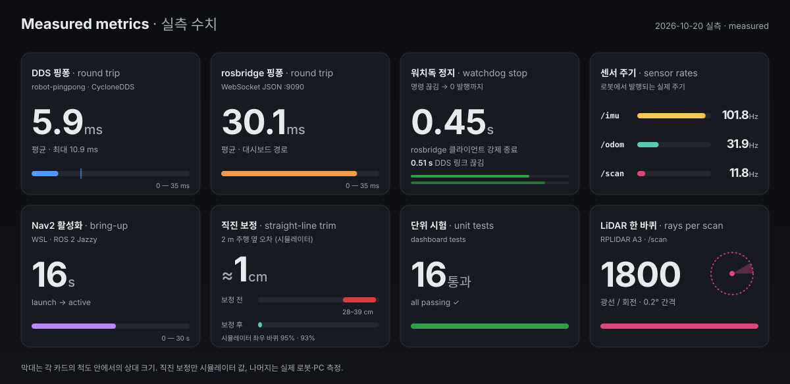

<sub>2026-10-20, 실제 로봇(Wi-Fi) · Windows 11 PC 에서 측정. 직진 보정만 시뮬레이터 값입니다. 경량 모델(삼각형 72만 → 6.3만) 적용 후 대시보드는
평균 45~50 fps · 메모리 약 380 MB 입니다(이전 13~21 fps · 1.4 GB).</sub>

## 💾 설치

[Releases](https://github.com/ghlee0786/ros-mobile-robot/releases) 에서 `RobotDashboard-Setup-x.y.z.exe` 를 받아 실행합니다(Windows 10/11 64비트).
설치 마법사에서 제품 특징을 보고, 설치 위치(나만 · 모든 사용자)와 기본 설정(로봇 주소 · rosbridge 포트 · 업데이트 확인 · 바탕 화면 바로 가기)을 정합니다.

- **업그레이드** — 새 설치 파일을 그대로 실행하면 이전 프로그램 파일을 지우고 새로 깝니다. 로봇 주소 · 창 크기 같은 설정과
  `문서\RobotDashboard\records` 의 기록은 그대로 남습니다(제거할 때도 설정은 묻고 나서만 지웁니다).
- **자동 업데이트 알림** — 대시보드가 시작 10 초 뒤와 6 시간마다 이 저장소의 최신 릴리스를 확인해, 새 버전이면 위쪽에 배너를 띄웁니다:
  변경 내역 · **다운로드하고 설치**(받아서 무인 설치 후 다시 켬) · 이 버전 건너뛰기 · 나중에. 주행 중에는 설치하지 않습니다.
  `Ctrl+K` → '업데이트 확인' 으로 바로 확인하거나 자동 확인을 끌 수 있습니다.

## 🚀 로봇 없이 5분 만에

Windows 11 + Qt 6.8.3(MinGW) + Python/uv 만 있으면 됩니다.

```bat
git clone https://github.com/ghlee0786/ros-mobile-robot.git && cd ros-mobile-robot
tooling\pc\install_qt.ps1                      :: Qt 6.8.3 MinGW · CMake · Ninja (한 번만, 기본 E:\Qt)
dashboard\build.cmd

:: 창 1 — 모의 로봇(차동 구동 · LiDAR 가상 방 · IMU · 지도 · Nav2 흉내 · 워치독)
uv run --no-project --with "websockets>=12,<14" python tooling\mockbridge\mock_rosbridge.py --port 9091 --nav --map-odom 0,0,0
:: 창 2 — 대시보드
dashboard\run_test.cmd --url ws://127.0.0.1:9091
```

조종 잠금을 풀고(`Ctrl+Enter` 또는 버튼 길게 누르기) `W A S D` 로 몰거나, 3D 뷰에서 **목표** 도구로 바닥을 누른 채 끌어 보세요.
3D 로봇은 저장소에 들어 있는 경량 모델(`dashboard/model/*.glb`, Fusion 360 설계에서 내보내 72만 → 6.3만 삼각형으로 줄인 것)로 그립니다.
파일을 지우거나 `--no-model` 로 띄우면 기본 도형으로 그립니다.

## 🤖 실제 로봇

| 부품 | 내용 |
|---|---|
| 컴퓨터 | Raspberry Pi 4 Model B (4 GB) · Ubuntu 20.04 · ROS 2 Foxy · CycloneDDS(도메인 7) |
| 모터 제어 | Raspberry Pi Pico (RP2040) · MD10C × 2 · 24 V 엔코더 모터 × 2 · PID 30 ms · USB 시리얼(CRC16) — `firmware/pwm-pico` |
| 센서 | RPLIDAR A3 · CMP10A IMU |
| 치수 · 한계 | 바퀴 반지름 0.05 m · 간격 0.34 m · 0.1 m/s · 0.25 rad/s |

```bash
# PC 에서 한 번만 (파이는 공유기에 연결, SSH 키 등록 후)
WIFI_SSID=<와이파이> WIFI_PASSWORD=<비밀번호> ssh rpi 'sudo -E bash -s' < tooling/rpi/apply_network.sh
tooling/rpi/deploy_robot_link.sh rpi          # 서비스 7개 설치 · 부팅 시 자동 실행
```

이후로는 파이 전원만 켜면 Wi-Fi(192.168.1.201)로 붙고 `robot-bringup` · `robot-rosbridge` · `robot-cmd-watchdog` · `robot-odom-tf` ·
`robot-straight-drive` · `robot-pingpong` · `robot-nav-relay` 가 올라옵니다.

| 하고 싶은 것 | 실행 |
|---|---|
| 대시보드 | `dashboard\run.cmd` |
| 지도 만들기(SLAM + Nav2 + RViz) | `tooling\pc\map_start.cmd` → `tooling\pc\map_save.cmd` |
| 저장한 지도로 이동 | `tooling\pc\nav_start.cmd` → 초기 위치 도구 → 목표 |
| 터미널 키보드 조종 | `tooling\pc\teleop.cmd` |
| 실기 점검(명령을 보내지 않음) | `uv run … python tooling\mockbridge\pi_suite.py --host 192.168.1.201` |

## 🧪 시험 — 로봇 없이도 검증한다

| 층 | 무엇 | 실행 |
|---|---|---|
| 단위 | C++ 단위 시험(QtTest, offscreen) — 메시지 해석 · rosbridge 구독 정책 · 재연결 · 큰 지도 · 플롯 엔진 · 장면 계산 · 점검 모델 | `dashboard\test.cmd` |
| 모의 서버 | rosbridge 프로토콜 · 시뮬레이션 · 장애 주입 · 기록/재생 pytest | `checks\p1_mockbridge.cmd` |
| 시나리오 | 모의 서버 + 실제 대시보드를 짝지어 띄우고 `state.json` · 캡처 · 서버 로그로 판정 | `run_scenarios.py --offline` |
| 실기 | 계약(실기 대 모의 서버 차이) · 120 s 기록 · 대시보드 30 s — 로봇에 명령을 보내지 않음 | `pi_suite.py --host <파이>` |

<details>
<summary><b>시나리오 목록</b></summary>

| id | 무엇을 확인하나 |
|---|---|
| `normal` | 연결 · 필수 토픽 · throttle · 5 s 전진 |
| `reconnect` | 서버 끊기 · 재시작 뒤 같은 구독 집합 재수신 |
| `halfopen` | 소켓은 살아 있는데 아무것도 오지 않는 연결을 감지하고 다시 붙음 |
| `freeze` · `wifi_bad` | 송신 6 s 멈춤 → 끊김 표시 · 회복 / 지연 80±60 ms · 유실 2% 에서 오탐 없음 |
| `estop` | 주행 · 직진 중 비상 정지 → 100 ms 안에 0 속도 3 회 · 직진 취소 · Nav2 목표 취소 |
| `flood` | IMU 1 kHz 폭주 중에도 조종 명령 10 Hz ± 10% |
| `goal` · `mapflip` | map 프레임 목표 역변환 2 cm · 5° 안 / 지도 방향 · 축척 |
| `bigmap` | 2000² 지도에도 GUI 가 막히지 않음 |
| `record_throttle` · `replay` | 기록이 throttle 을 풀지 않음 / 실기 기록 재생 |
| `skew` · `bad_json` · `no_rosapi` · `two_clients` · `watchdog_mock` | 시계 차 · 깨진 메시지 · rosapi 무응답 · 대시보드 2 개 · 워치독 없음 |
| `soak` | 10 분 반복 재생 동안 메모리 증가 상한 |
| `scene_layout_1280` · `scene_layout_1920` | 창 크기별 배치(잘림 없음) |
| `pi_normal` · `pi_link` | 실기 연결 · 필수 토픽 · 워치독 (발행 없음) |

</details>

## 💡 무엇에서 배웠나

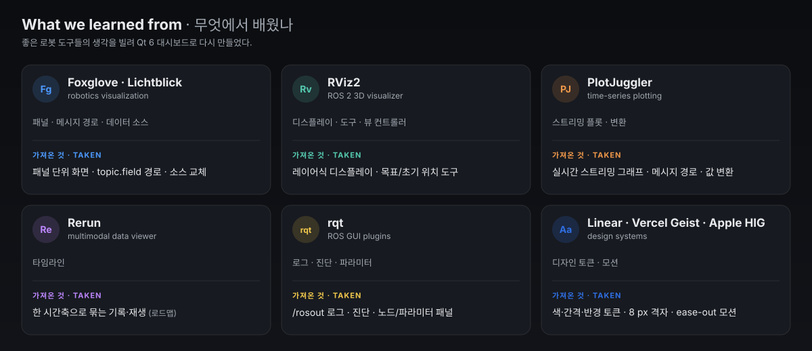

Foxglove/Lichtblick · RViz2 · PlotJuggler · Rerun · rqt 의 코드를 읽고 패널 · 메시지 경로 · 디스플레이 · 도구 · 스트리밍 플롯 · 로그 뷰를
가져왔고, Linear · Vercel Geist · Apple HIG · Foxglove 의 디자인 원칙(중립 회색 계층 + 강조색 하나, 4/8 pt 간격, tabular 숫자,
150~250 ms 모션, 키보드 우선)을 디자인 토큰으로 옮겼습니다.

## 🗂 저장소 구조

| 경로 | 내용 |
|---|---|
| `dashboard/` | Qt 6 C++/QML 대시보드 — `src/`(rosbridge · robot · plot · scene · tools · 시험 훅), `qml/`(Theme · components · dash · scene · inspector), `tests/` |
| `tooling/mockbridge/` | 모의 rosbridge 서버 · 장애 주입 · 기록/재생 · 시나리오 실행기 · 실기 점검 · 데모 GIF |
| `tooling/rpi/` | 파이 네트워크 · `robot_link` 서비스(워치독 · TF · 직진 · 핑퐁 · 내비 중계) · 배포 · 패치 |
| `tooling/nav/` | SLAM/Nav2 실행 · 파라미터 · 도메인 중계(split_relay) · 지도 저장 · 목표 이동 |
| `tooling/wsl/` · `tooling/pc/` | WSL(ROS 2 Jazzy) 설치 · DDS 점검 · RViz · 키보드 조종 / Windows 설정 · 실행용 `.cmd` |
| `tooling/fusion/` | Fusion 360 설계 → 대시보드 모델 변환 · 경량화(glb) |
| `tooling/sim/` | 직진 제어 · 워치독 시뮬레이터 |
| `ros_ws/src/` · `firmware/pwm-pico/` | 로봇 ROS 2 패키지 · Pico 펌웨어(서브모듈) |
| `checks/` · `docs/assets/` | 검사 스크립트 / README 그림 |

## 🛣 로드맵

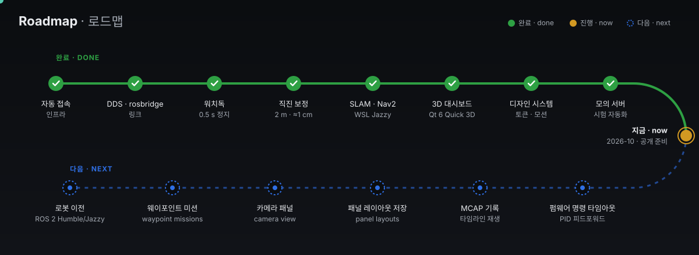

## 🤝 함께 만들기

로봇이 없어도 됩니다 — 모의 서버와 시나리오로 거의 모든 기능을 개발 · 검증할 수 있습니다. [CONTRIBUTING.md](CONTRIBUTING.md) 에
개발 환경 · 시나리오 쓰는 법 · 지켜야 할 것(안전 · 파이 부하 · 디자인 토큰)과 **처음 해 보기 좋은 일** 목록이 있습니다.
버그와 아이디어는 [Issues](https://github.com/ghlee0786/ros-mobile-robot/issues), 질문은
[Discussions](https://github.com/ghlee0786/ros-mobile-robot/discussions) 로 남겨 주세요.

## ⚠️ 안전 · 알려진 문제

- 로봇을 움직이는 시험은 **사람이 옆에 있을 때만**, 처음에는 바퀴를 바닥에서 띄우고 합니다.
- Pico 펌웨어와 `control_node` 에는 명령 타임아웃이 없습니다 — 원격 명령은 반드시 `/teleop/cmd_vel`(워치독)로 보냅니다.
- rosbridge · 내비 중계 포트에는 인증이 없습니다. 신뢰하는 LAN 에서만 쓰세요([SECURITY.md](SECURITY.md)).
- 파이의 rosbridge(Python)는 한 코어가 상한입니다. 내비 스택 토픽까지 함께 받으면 텔레메트리가 20 Hz 안팎으로 내려갑니다 —
  C++ 브리지(foxglove_bridge 등, 바이너리 CDR)로 바꾸는 것이 다음 단계입니다.
- 3D 지도의 빈칸이 RViz2 보다 조금 어둡게 보입니다(장면의 필름식 톤 매핑). 고치는 작업이 진행 중입니다.
- 파이 Foxy 는 지원 종료(EOL) 판입니다. 로봇을 Humble/Jazzy 로 옮기는 것이 로드맵에 있습니다.
- CAD 의 바퀴 간격(313.5 mm)과 실측 설정(340 mm)이 다릅니다 — 대시보드는 설정값을 따릅니다.

## 📄 라이선스

이 저장소의 코드는 [MIT](LICENSE) 입니다. 서브모듈(`ros_ws/src/*`, `firmware/pwm-pico`)은 각 저장소의 라이선스를 따릅니다.
